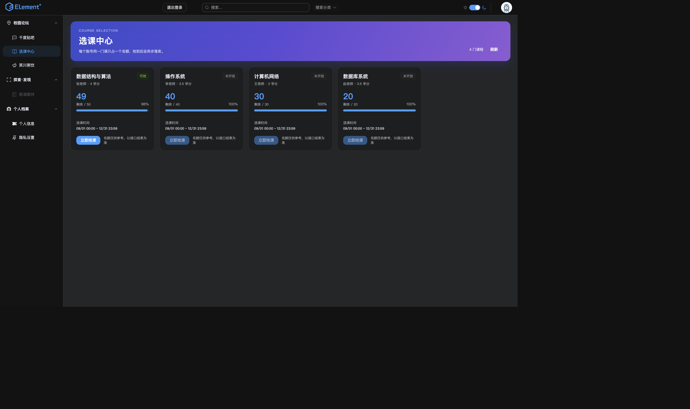
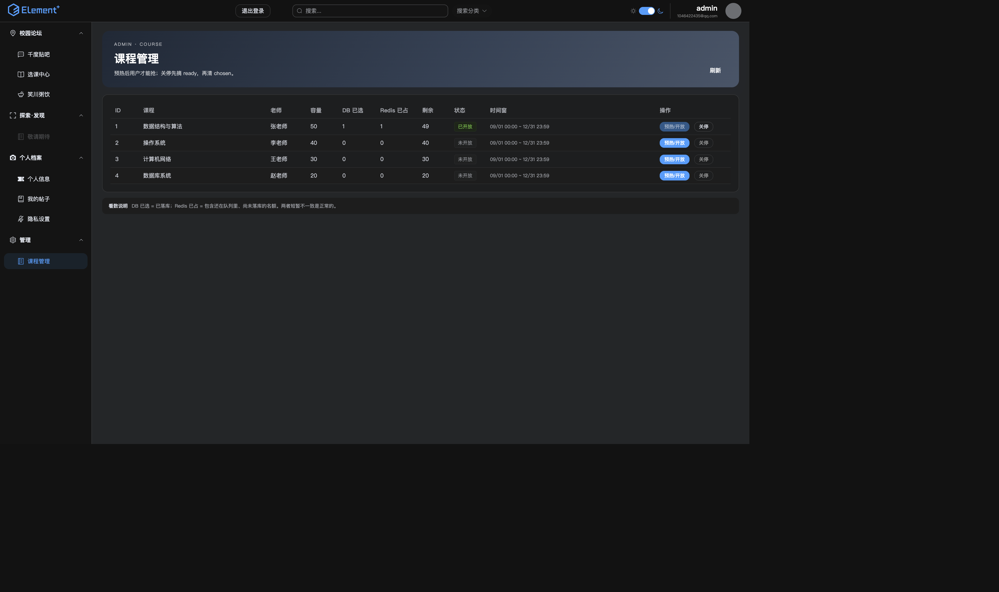

# 选课前端示例

> 状态：可运行的示例，不是最终视觉稿。路由和接口已接通，样式可以直接改。

## 页面

| 路由 | 页面 | 说明 |
|---|---|---|
| `/index/course` | 选课中心 | 课程卡片、剩余名额、状态、抢课按钮、结果轮询 |
| `/index/admin-courses` | 课程管理 | 管理员表格、预热/关停、DB 已选 vs Redis 已占 |

侧栏入口：

- “校园论坛 → 选课中心”对所有登录用户显示；
- “管理 → 课程管理”只在 `store.user.role === 'ADMIN'` 时显示，接口本身还有 `ROLE_ADMIN` 兜底。





## 依赖的接口

```text
GET  /api/course/list          # 用户：remaining 已优先读 Redis chosen
GET  /api/admin/course/list    # 管理员：多返回 ready / chosenCount
POST /api/course/select        # 抢课
GET  /api/course/result        # 轮询最终结果
POST /api/admin/course/preheat # 预热
POST /api/admin/course/close   # 关停
```

`CourseVo` 新增 `ready`；admin 列表的 `selectedCount` 是 DB 已落库，`chosenCount`
是 Redis 已预扣，两者短暂不一致是正常的。

## 本地跑

```bash
# 后端 8080（Vite proxy 的 target）
cd my-project-backend
mvn spring-boot:run -Dspring-boot.run.arguments=--server.port=8080

# 前端 5173
cd my-project-frontend
npm run dev
```

登录后访问：

```text
http://127.0.0.1:5173/index/course
http://127.0.0.1:5173/index/admin-courses
```

管理员页需要账号 `role='ADMIN'` 并重新登录；只改 JWT 不行，因为侧栏读的是
`/api/user/info` 返回的角色。

## 还没做

- 视觉稿/设计系统、响应式细节、浅色模式实际检查；
- “我的选课”列表（需要查 `db_course_selection`）；
- 取消选课、候补、通知；
- 抢课结果的前端持久化（刷新后不保留“排队中”状态，只从接口重新查）。
